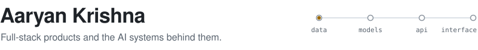

<picture>
  <source media="(prefers-color-scheme: dark)" srcset="assets/header-dark.svg">
  <source media="(prefers-color-scheme: light)" srcset="assets/header-light.svg">
  
</picture>

I build web products end to end, from the database schema to the interface, and I'm going deeper into applied AI and data engineering.

Recent work includes a next-day wildfire spread model, an AI career guidance platform and a booking system for live events.

### Skills

<picture>
  <source media="(prefers-color-scheme: dark)" srcset="assets/stack-dark.svg">
  <source media="(prefers-color-scheme: light)" srcset="assets/stack-light.svg">
  
</picture>

| Area | What I use it for |
| :-- | :-- |
| **AI and ML** | XGBoost, LightGBM, CNNs and U-Nets, RAG pipelines, embeddings, FAISS, OpenAI API |
| **Data** | Pandas, NumPy, Tableau, Looker Studio, Excel, data cleaning and reporting |
| **Automation** | Selenium pipelines with checkpointing and recovery |
| **Backend** | REST APIs, JWT and role-based auth, Stripe payments and webhooks |
| **Networking** | DNS, TLS, nginx reverse proxying and load balancing, Wireshark |
| **Fundamentals** | Data structures and algorithms |
| **Learning** | System design, deeper machine learning |

### Selected work

<table>
<tr>
<td width="50%" valign="top">
<a href="https://github.com/aaryan-codes56/rex-ai"><strong>RexAI</strong></a> · <a href="https://rexxai.netlify.app/">live</a> 
Career guidance with AI recommendations, course discovery and a resume builder. 
React · Express · MongoDB · OpenAI
</td>
<td width="50%" valign="top">
<a href="https://github.com/aaryan-codes56/poppin-flea"><strong>PoppinFlea</strong></a> · <a href="https://www.poppinflea.in/">live</a> 
Table booking for live events, with per-day capacity limits, email confirmations and an admin check-in dashboard. I also ran branding and social for the event. 
Next.js · Google Sheets API · Nodemailer
</td>
</tr>
<tr>
<td width="50%" valign="top">
<a href="https://github.com/aaryan-codes56/brixton-studiox"><strong>Brixton StudioX</strong></a> · <a href="https://brixtonstudiox.vercel.app">live</a> 
Agency site with its own lead pipeline: Google Sheets sync, automated emails and an admin dashboard with CSV export. 
React · Tailwind CSS · Framer Motion
</td>
<td width="50%" valign="top">
<a href="https://github.com/aaryan-codes56/amara-home-service"><strong>Amara</strong></a> · <a href="https://amarasolutions.vercel.app">live</a> 
Find, compare and book local home service providers. 
React · Clerk
</td>
</tr>
<tr>
<td width="50%" valign="top">
<a href="https://github.com/vedant21-ctr/fireWild"><strong>fireWild</strong></a> · team 
Predicts where an active wildfire will burn the next day, tested on held-out locations and weeks. I built the CNN and U-Net models and the data-leakage controls. 
Python · XGBoost · LightGBM · U-Net
</td>
<td width="50%" valign="top">
<a href="https://github.com/Deepanshu-Nst/SectionE_G-4_UK-Road-Safety"><strong>UK Road Safety Analysis</strong></a> · team 
Analysis of about 1.8 million UK accident records to find high-risk patterns. I worked on the report and presentation. 
Python · Pandas · Tableau
</td>
</tr>
<tr>
<td width="50%" valign="top">
<a href="https://github.com/RahulDwivedi205/G11_DVA_Capstone"><strong>Cardiovascular Risk Analysis</strong></a> · team 
Analysis of about 10,000 patient records, linking lifestyle factors to clinical measures, with a dashboard. I worked on the project files and write-up. 
Google Sheets · Excel · Python
</td>
<td width="50%" valign="top">
<a href="https://github.com/AradhyaTiwari10/scms"><strong>SCMS</strong></a> · <a href="https://scms-rust.vercel.app">live</a> · team 
Campus platform for admins, faculty and students. I built the login API, JWT auth, signup and the role-based dashboard. 
Next.js · Express · MongoDB · JWT
</td>
</tr>
</table>

### Stats

<picture><source media="(prefers-color-scheme: dark)" srcset="assets/stats-overview-dark.svg"><source media="(prefers-color-scheme: light)" srcset="assets/stats-overview-light.svg"></picture>
<picture><source media="(prefers-color-scheme: dark)" srcset="assets/stats-monthly-dark.svg"><source media="(prefers-color-scheme: light)" srcset="assets/stats-monthly-light.svg"></picture>
<picture><source media="(prefers-color-scheme: dark)" srcset="assets/stats-repos-dark.svg"><source media="(prefers-color-scheme: light)" srcset="assets/stats-repos-light.svg"></picture>
<picture><source media="(prefers-color-scheme: dark)" srcset="assets/stats-languages-dark.svg"><source media="(prefers-color-scheme: light)" srcset="assets/stats-languages-light.svg"></picture>
<picture><source media="(prefers-color-scheme: dark)" srcset="assets/stats-weekday-dark.svg"><source media="(prefers-color-scheme: light)" srcset="assets/stats-weekday-light.svg"></picture>
<picture><source media="(prefers-color-scheme: dark)" srcset="assets/stats-leetcode-dark.svg"><source media="(prefers-color-scheme: light)" srcset="assets/stats-leetcode-light.svg"></picture>

